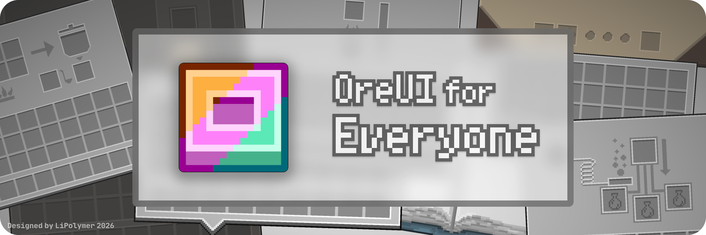

<div align="center">
  <h1>OreUI For Everyone · Forked</h1>

  

  [](https://www.minecraft.net/)
  [](https://github.com/ReConstruction-127/OreUI-For-Everyone-1.20.1)
  [](LICENSE)

  <p><strong>把 OreUI 带到更高版本的 Minecraft。</strong></p>
  <p>面向 Minecraft Java Edition 1.21.1 的模组界面资源包，由 <a href="https://github.com/ReConstruction-127/OreUI-For-Everyone-1.20.1">OreUI For Everyone 1.20.1</a> 移植而来。</p>
</div>

## 简介

**OreUI For Everyone** 将 [Applied Energistics 2（AE2）](https://modrinth.com/mod/ae2) 的 OreUI 视觉风格移植到原版与其他模组的界面中，让整合包里的按钮、槽位、面板和交互界面保持统一的观感。

本仓库是它的**高版本移植分支**：在保留上游全部适配的基础上，将资源结构对齐 1.21.1，并合并 [OreUIForEveryone-1.21.1-Extended](https://github.com/OnDreamQwQ/OreUIForEveryone-1.21.1-Extended) 的扩展内容。

目前覆盖 **99 个命名空间**、约 **3000 个**纹理文件，包括 Minecraft 原版界面与 Create、Mekanism、Thermal Series、JEI、FTB、Tinkers' Construct、Refined Storage、ComputerCraft、Apotheosis、Supplementaries、Simulated、Aeroworks、Synaxis 等常用模组及其附属。

> [!NOTE]
> 实际显示效果取决于所安装的模组与版本，完整适配及贡献记录请查看 [`contributor.txt`](contributor.txt)。

## 与上游的关系

| 仓库 | 目标版本 | 作用 |
| --- | --- | --- |
| [OreUI-For-Everyone-1.20.1](https://github.com/ReConstruction-127/OreUI-For-Everyone-1.20.1) | 1.20.1 | 上游源仓库，主体纹理的来源 |
| [OreUIForEveryone-1.21.1-Extended](https://github.com/OnDreamQwQ/OreUIForEveryone-1.21.1-Extended) | 1.21.1 | 1.21.1 扩展包，补充额外模组的适配 |
| **本仓库** | **1.21.1** | 上游 + 扩展包的合并移植，附带自动化同步脚本 |

## 效果预览

<p align="center">
  
</p>

<p align="center">
  
  
  
</p>

## 安装

1. 从 [Releases](https://github.com/RyanLuoJiayuan1120/OreUI-For-Everyone-forked/releases) 下载最新的 `OreUI-For-Everyone-forked_*.zip`（也可自行构建，见下文）。
2. 将压缩包放入 `.minecraft/resourcepacks` 目录，**无需解压**。
3. 在游戏中打开「选项 → 资源包」，启用 **OreUI For Everyone**。
4. 若同时使用其他修改 GUI 的资源包，请将本资源包置于更高优先级。

## 构建本项目

仓库同时提供 `Makefile` 与 Windows 批处理脚本，两者的产物均为 `build/OreUI-For-Everyone-forked_3.0.zip`。

**跨平台（推荐）**，依赖 `rsync` 与 `zip`：

```bash
git clone https://github.com/RyanLuoJiayuan1120/OreUI-For-Everyone-forked.git
cd OreUI-For-Everyone-forked
make            # 等价于 make build
```

**Windows**，双击或在命令行运行：

```powershell
.\AutoPacking.bat
```

**持续集成**：向任意分支推送后，GitHub Actions（[`build.yml`](.github/workflows/build.yml)）会自动执行 `make`，生成 `build-N` 标签的 Release 并附上资源包。

## 目录结构

```text
OreUI-For-Everyone-forked/
├── assets/                  # 资源主体，按模组命名空间组织（99 个）
├── readmeAssets/            # README 使用的预览图
├── build/                   # 打包产物（构建时生成）
├── pack.mcmeta              # 资源包元数据
├── pack.png                 # 资源包图标
├── contributor.txt          # 贡献者与适配记录
├── Makefile                 # 跨平台构建脚本
├── AutoPacking.bat          # Windows 一键打包
├── sync-upstream.sh         # 从上游同步更新
├── merge-extended.sh        # 合并 Extended 扩展包
└── .github/workflows/       # CI 自动构建与发布
```

## 与上游保持同步

本仓库自带两个脚本，便于把上游改动与扩展包并入：

```bash
# 从上游同步（冲突一律以上游为准，合并后需自行 push）
./sync-upstream.sh

# 合并 Extended 扩展包（交互式选择命名空间）
./merge-extended.sh --src /path/to/OreUIForEveryone-1.21.1-Extended

# 常用选项
./merge-extended.sh --dry-run                  # 只打印计划，不改动文件
./merge-extended.sh --only mekanism --yes      # 只处理指定命名空间
./merge-extended.sh --prefer extended --yes    # 冲突时用扩展包版本覆盖
```

执行 `./merge-extended.sh --help` 可查看全部参数。

## 参与贡献

欢迎适配更多模组或完善现有纹理：

1. Fork 本仓库并创建分支。
2. 将适配资源放入 `assets/<mod_id>/` 对应路径。
3. 在 [`contributor.txt`](contributor.txt) 中填写你的名字、模组 ID 与贡献内容。
4. 确认资源路径及界面显示无误后提交 Pull Request。

问题反馈与建议请前往 [Issues](https://github.com/RyanLuoJiayuan1120/OreUI-For-Everyone-forked/issues)。

## 相关项目

- [OreUI-For-Everyone-1.20.1](https://github.com/ReConstruction-127/OreUI-For-Everyone-1.20.1) - 上游源项目（1.20.1）
- [OreUIForEveryone-1.21.1-Extended](https://github.com/OnDreamQwQ/OreUIForEveryone-1.21.1-Extended) - 适用于 1.21.1 的 OreUI 扩展包
- [OreUI-For-Everyone-1.21.1](https://github.com/LiPolymer/OreUI-For-Everyone-1.21.1) [`GitLab`](https://gitlab.com/LiPolymer/OreUI-For-Everyone-1.21.1) - 上游的 1.21+ 支持，采用补丁形式存储
    - 正式构建可在 OreUI-For-Everyone 的 Modrinth / CurseForge 页面获取，测试构建请前往 [GitLab Pipelines](https://gitlab.com/LiPolymer/OreUI-For-Everyone-1.21.1/-/pipelines)
- [OreUI For Windows](https://github.com/ReConstruction-127/OreUI-For-Windows) - 适用于 Windows 10/11 的 OreUI 视觉改造

## 致谢

感谢 **Re_Construction、Delta、AL、jihan_hanhan、万梦qwq、OnDreamQwQ** 以及所有参与测试、反馈和适配工作的贡献者。详细贡献记录见 [`contributor.txt`](contributor.txt)。

## 许可证

本项目基于 [GNU Affero General Public License v3.0](LICENSE) 开源。

---
